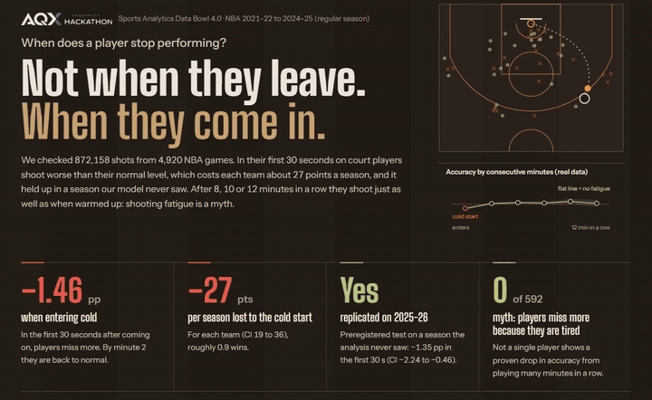
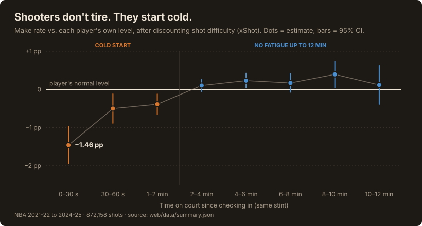
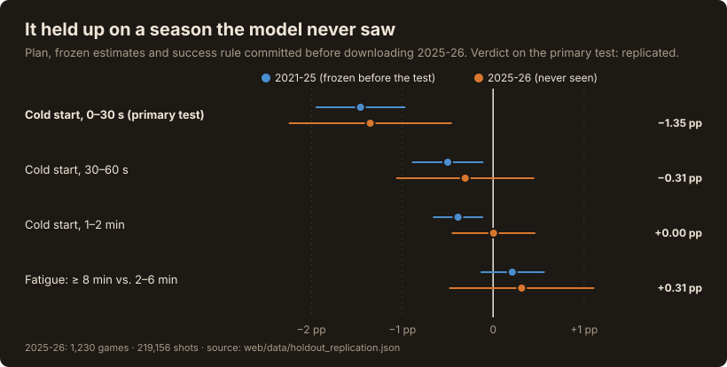
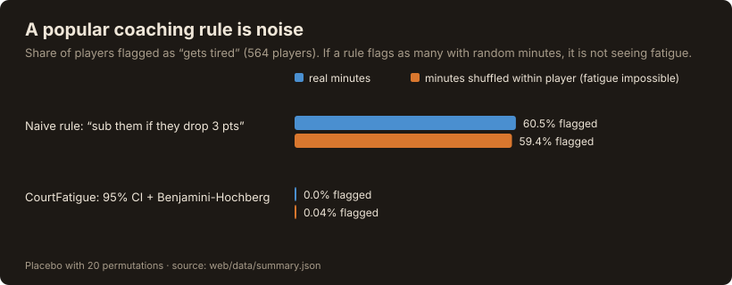
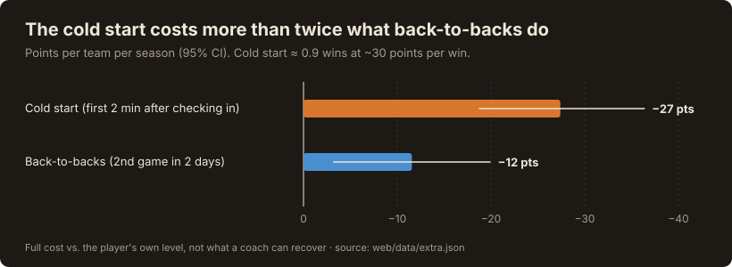

[English](README.md) | [Español](README.es.md)

# CourtFatigue: los tiradores de la NBA no se cansan, arrancan fríos

**▶ App en vivo: https://courtfatigue-web.vercel.app/?lang=es** · **[🎬 Video](https://youtu.be/sOfh15Tk0wY)** · [Devpost](https://devpost.com/software/courtfatigue) · Hecho para el **AQX Sports Analytics Data Bowl 4.0** · Licencia MIT

> **Los entrenadores se preocupan por el minuto 10. La fuga está en el segundo 10.**
>
> 1 de cada 4 tiros de la NBA se lanza en los 2 primeros minutos tras entrar a cancha. En los primeros 30 segundos, los jugadores tiran **1.46 pp por debajo de su propio nivel**, y **se replicó en una temporada que el modelo nunca vio**. Son **~27 puntos por equipo y temporada**: más del doble de lo que cuestan los back-to-backs, y casi una victoria.

[](https://youtu.be/sOfh15Tk0wY)

*Haz clic en la animación para ver el video completo en YouTube (en inglés).*

| | Resultado | IC 95% |
|---|---|---|
| **Arranque frío** (primeros 30 s tras entrar) | **−1.46 pp** frente al nivel propio del jugador | −1.95 a −0.97 |
| **Replicación preregistrada** en 2025-26 (nunca vista; plan publicado antes de descargarla) | **−1.35 pp** → replicado | −2.24 a −0.46 |
| Costo del arranque frío | **~27 puntos por equipo y temporada** (≈ 0.9 victorias) | 19 a 36 |
| "Cansancio de tiro" tras ≥ 8 min seguidos (frente a jugadores ya calentados, 2–6 min) | **+0.21 pp**: ninguno | −0.13 a +0.56 |
| Jugadores con caída por cansancio demostrable | **0 de 592** | con corrección FDR |

- **El mito se equivoca en una dirección útil.** Los entrenadores sacan a los tiradores "antes de que se cansen", pero el acierto no cae hasta ~12 minutos seguidos.
- **La fuga real está en la entrada.** Los tiros de los primeros 30 s tras un cambio son los peores, incluso los tiros libres (−1.9 pp), donde no hay defensor. Uno de cada cuatro tiros (24.6%) se lanza en los 2 primeros minutos tras entrar.
- **Qué puede hacer un cuerpo técnico mañana:** diseñar la primera posesión tras un cambio para el tiro que menos sufre el arranque frío (cerca del aro: −0.8 pp, frente a −1.8 pp en triples y −2.6 pp a media distancia) y activar al suplente antes de que entre. Todavía no se ha probado si así se recuperan los puntos.

### Un tiro concreto (calculadora de banca)

Jayson Tatum vuelve a cancha tras 8 minutos en la banca. A los 15 segundos le llega un triple.

- Probabilidad esperada de acierto, 15 s después de entrar: **33.6%** (intervalo 95%: 31.3% a 35.9%)
- El mismo triple cuando ya lleva 2 minutos o más en cancha: **35.5%**
- Cerca del aro, en el mismo momento, el arranque frío solo cuesta −0.9 pp (59.0% frente a 59.9%)

Esa diferencia es lo que un entrenador puede planificar. Pruébalo en la app, en *Herramientas → Calculadora*.

## La evidencia en cuatro gráficos

Cada número de estos gráficos se lee de los mismos archivos que usa la app (`web/data/`), con `scripts/build_readme_figures.py`. Los gráficos están en inglés, el idioma por defecto de la app.









> **Cómo leer la replicación con honestidad.** La prueba principal preregistrada (primeros 30 s) se replicó. Las ventanas más pequeñas de 30–60 s y 1–2 min apuntan en la misma dirección en 2021-25, pero por sí solas no se distinguen de cero en 2025-26. La ausencia de cansancio también se mantuvo (+0.31 pp).

## Cómo cumple los criterios de evaluación del Data Bowl

| Criterio | Dónde lo cumple CourtFatigue |
|---|---|
| **Aplicación práctica** | Tarjeta imprimible de una página para el entrenador; calculadora de banca para el siguiente tiro tras un cambio; costo en puntos por equipo y temporada; lista explícita de lo que la herramienta *no* hace |
| **Valor analítico** | Modelo de dificultad del tiro (xShot) validado por partido y en una temporada no vista; efectos fijos por jugador con errores agrupados; efectos aleatorios + Benjamini-Hochberg; prueba placebo; sesgo de selección separado según cómo terminan los stints; **replicación preregistrada en 2025-26** |
| **Presentación de los datos** | App web bilingüe (EN/ES); primero el resumen en lenguaje simple y debajo el detalle técnico; simulador 3D que muestra qué pesa más en un tiro; cada número con su IC 95% |
| Prototipo funcional | https://courtfatigue-web.vercel.app/ |
| Código abierto | este repositorio ([MIT](LICENSE)) |

## Validación

| Comprobación | Resultado | Línea base / referencia |
|---|---|---|
| xShot, validación cruzada por partido | log-loss 0.640, Brier 0.225, AUC 0.657, error de calibración 0.17 pp | sin modelo: log-loss 0.691 · regresión logística: 0.646 |
| xShot, temporada no vista (entrena 2021-24 → evalúa 2024-25) | log-loss 0.641, AUC 0.654, error de calibración 0.50 pp | sin modelo: 0.691 · regresión logística: 0.646 |
| Placebo (minutos barajados dentro de cada jugador) | nuestra regla marca al 0.04% | la regla ingenua de "caída de 3 puntos" marca al 59.4%, frente al 60.5% con datos reales: es ruido |
| Replicación preregistrada, 2025-26 | arranque frío −1.35 pp (IC −2.24 a −0.46) | estimación congelada −1.46 pp |
| Adaptador de stints para el nuevo formato de play-by-play | el 99.66% de los tiros de 2024-25 recibe el mismo stint | formato original |
| Sesgo de selección: stints terminados por causas ajenas al entrenador (medio tiempo, fin del partido, faltas) | sin caída: +0.83 pp (IC +0.24 a +1.41) | todos los stints: +0.20 pp |
| Pruebas | 6 pruebas estadísticas con datos sintéticos · 37 comprobaciones de la calculadora · 179 del simulador | `tests/` |

## Resultado principal en detalle

**Datos:** temporadas regulares NBA 2021-22 a 2024-25 · 4,920 partidos · 872,158 tiros · 913 jugadores. La 2025-26 (1,230 partidos, 219,156 tiros) se usa **solo** para la replicación preregistrada.

| Pregunta | Resultado |
| --- | --- |
| ¿Cae el acierto tras ≥ 8 min seguidos, frente a un jugador ya calentado (2-6 min)? | **+0.21 pp** (IC 95%: −0.13 a +0.56): no. Se descartan caídas promedio mayores a ~0.13 pp |
| Pendiente por minuto seguido, tras calentar | +0.027 pp/min (IC 95%: −0.014 a +0.069): plana |
| ¿Se repite temporada por temporada? | Sí: +0.41, +0.32, −0.36 y +0.18 pp (todos con IC que incluye 0); +0.31 pp en 2025-26 |
| Jugadores con caída demostrable (IC 95% < 0 y corrección FDR) | **0 de 592** |
| Zonas de la cancha con caída significativa (tras calentar) | **0 de 6**. Las dos interiores muestran una mejora leve (+0.11 y +0.16 pp/min) |
| Características del jugador que modifican el efecto | **0 de 7** |
| **Arranque frío** (tras entrar a cancha) | **−1.46 pp** en los primeros 30 s (IC −1.95 a −0.97), −0.50 pp entre 30 y 60 s, −0.39 pp entre 1 y 2 min; normal desde los 2 min. Negativo en las 4 temporadas (intervalo claro en 3 de 4); con otra regla de stints (reinicio en cada cuarto) sigue en −1.08 pp (IC −1.50 a −0.65). **Replicado en 2025-26: −1.35 pp** |
| Arranque frío por tipo de tiro (primeros 30 s) | triple −1.8 pp · media distancia −2.6 pp · cerca del aro −0.8 pp · tiros libres −1.9 pp |
| ¿Importa el tiempo en la banca? | No: −0.04 pp por minuto de banca (IC −0.12 a +0.03). Es entrar en el ritmo del partido, no enfriarse |
| Costo en puntos | arranque frío **−27 puntos por equipo y temporada** (IC −36 a −19, ≈ 0.9 victorias); back-to-backs −12 (IC −20 a −3) |
| Calendario y contexto | back-to-back **−0.39 pp** (IC −0.67 a −0.11); jugar en casa **+0.38 pp** (IC +0.11 a +0.65) |
| Defensa del rival | Efecto real y estable entre temporadas (r ≈ 0.52): de −1.2 pp (Thunder) a +1.7 pp (Kings) en 2024-25 |
| Equipos | Ningún equipo maneja el arranque frío mejor que otros más allá del ruido (dispersión entre equipos τ = 0 en las cuatro temporadas), así que la auditoría por equipo no se presenta como ranking |

**No hay fatiga de tiro detectable hasta ~12 minutos seguidos.** Es compatible con que las rotaciones actuales ya evitan los tramos donde el tiro se deterioraría. Lo que sí se ve es un **arranque frío**, y calendario y localía con efectos pequeños pero consistentes. A nivel individual la potencia es limitada: el error estándar típico por jugador es de ~5 pp, así que solo se detectarían caídas de unos 14 pp o más. Por eso la herramienta no etiqueta a ningún jugador como "el que se cansa", y lo dice.

> **Por qué la comparación es contra jugadores ya calentados.** Comparar ≥ 8 min contra todo lo que sea < 4 min da +0.65 pp, pero eso mezcla el arranque frío con la fatiga. Con la referencia de 2-6 min el efecto baja a +0.21 pp. La pendiente con todos los tramos (+0.097 pp/min) también está inflada por el arranque; tras calentar es +0.027.

### Por qué importa la inferencia: la regla ingenua no funciona
Una regla del tipo *"sustituir cuando el acierto cae 3 puntos en algún tramo con ≥ 20 tiros"* marca al **60.5%** de los jugadores con los datos reales y al **59.4%** cuando los minutos se barajan al azar dentro de cada jugador (donde la fatiga no puede existir). Es ruido. La regla de este proyecto (IC 95% excluye 0 y corrección de Benjamini-Hochberg) marca **0%** con los datos reales y 0.04% con los minutos al azar. Esta comparación está en la pestaña *Resumen* y se verifica con pruebas sintéticas en `tests/`.

### Sesgo de selección: ¿los entrenadores esconden la fatiga?
Los entrenadores sacan a quien ven cansado, y eso podría ocultar una caída real. Por eso los stints se separaron según cómo terminaron. En los stints que terminaron por razones que el entrenador no elige (medio tiempo, fin del partido, problemas de faltas) sigue sin haber caída: **+0.83 pp** (IC +0.24 a +1.41). En los stints que terminó el entrenador, los últimos 2 minutos antes del cambio están **−9.0 pp** por debajo de lo normal, frente a −1.9 pp en los últimos 2 minutos de los demás stints: los entrenadores reaccionan a los fallos recientes, no a los minutos jugados. Sigue siendo asociación, no causalidad.

### Robustez
La pendiente por minuto resiste: excluir partidos decididos (diferencia ≥ 20), usar solo partidos parejos (≤ 10), controlar por minutos del partido, local o visitante, marcador y back-to-back, reiniciar el contador en cada cuarto e incluir los tiros con stint incierto (todas entre +0.09 y +0.11 pp/min con todos los tramos; tras calentar, +0.027).

## Uso y beneficios para el cuerpo técnico

CourtFatigue **no es un asistente para usar durante el partido**: es una herramienta para planificar y desmontar mitos. Dice dónde no gastar energía y dónde poner atención. En la web está en la pestaña **Para el entrenador**, con una tarjeta imprimible de una página.

**Para qué sí sirve**

| Uso | Qué hace el entrenador | En qué se apoya |
| --- | --- | --- |
| Rotar sin miedo al "cansancio de tiro" | Dejar más tiempo al mejor tirador si no hay otras razones (faltas, defensa, desgaste visible) para sacarlo | Hasta ~12 min seguidos el acierto no cae (+0.21 pp tras ≥ 8 min; IC −0.13 a +0.56) |
| Preparar la entrada desde la banca | Primera jugada tras un cambio pensada para el tiro menos afectado (cerca del aro), no un triple tras bote ni un tiro de media distancia; activar al suplente antes de entrar (hipótesis a validar) | Arranque frío: −1.46 pp en los primeros 30 s, replicado en 2025-26; −0.8 pp cerca del aro frente a −1.8 pp en triples |
| Dosificar en los back-to-back | Decidir a quién dar menos minutos en el segundo partido de dos días seguidos | Back-to-back: −0.39 pp (IC −0.67 a −0.11), ~12 puntos por equipo y temporada |
| No etiquetar a nadie como "el que se cansa" | Revisar a cada jugador con su margen de error en *Herramientas → Verificar jugadores* antes de cambiar su rol | 0 de 592 jugadores con caída comprobada |
| Preparar el partido según el rival | Saber contra qué equipos se tira peor de lo esperado | Efecto defensivo por equipo, estable entre temporadas (r ≈ 0.52) |
| Convencer a jugadores y directivos | Mostrar en el simulador 3D qué pesa en un tiro: el defensor y la distancia mucho, el cansancio casi nada | Panel "Qué pesa más en este tiro" |

**Lo que no hace**

- No funciona en vivo: no dice "sácalo ahora" durante el partido.
- No mide el cansancio físico ni el riesgo de lesión, solo si el tiro entra. Para eso hacen falta datos de carga (GPS, frecuencia cardíaca).
- No mide defensa, rebotes ni pérdidas, que el cansancio sí podría afectar.
- No ve caídas pequeñas de un jugador concreto: solo de ≈ 14 pp o más.
- No dice nada más allá de ~12 minutos seguidos: casi no hay datos ahí.
- Los 27 puntos son el costo total del arranque frío, no lo que un entrenador puede recuperar: eso no se ha probado.

> **En una frase:** ayuda al cuerpo técnico a rotar con datos en vez de intuición. El problema no está en cuándo sale un jugador, sino en cómo entra.

## Interfaz

**En vivo:** https://courtfatigue-web.vercel.app/?lang=es

Pestañas: **Resumen** (la respuesta en lenguaje simple, cuatro cifras clave y la prueba placebo) · **Para el entrenador** (tarjeta imprimible de una página con cuatro hallazgos, cuatro acciones y la evidencia de cada una; cómo la usa un cuerpo técnico y qué no hace) · **Herramientas** (*Calculadora*: probabilidad esperada del siguiente tiro tras un cambio; *Verificar jugadores*: curva, IC, mapas descansado vs. cansado; *Jugador nuevo*: proyección con incertidumbre) · **Evidencia** (el arranque frío: replicación, costo en puntos, tipo de tiro, tiros libres, tiempo en la banca; la ausencia de fatiga: sesgo de selección, robustez, temporada por temporada, zonas, características; equipos: auditoría de puntos perdidos y defensa) · **Simulación 3D** (acceso al simulador + método).

El idioma (inglés o español) se elige con el selector EN / ES de la barra superior; se recuerda en el navegador y se comparte con el simulador. También se puede forzar con `?lang=es` o `?lang=en`. El diseño se inspira en una pizarra táctica: madera oscura, tinta blanco tiza y líneas finas de cancha en naranja como separadores.

La página es estática (carpeta `web/`), sin librerías salvo Three.js en el simulador. Está publicada en Vercel; `.github/workflows/pages.yml` también puede publicarla en GitHub Pages. Cómo ejecutarla en tu computadora: ver [Instrucciones para clonar y ejecutar](#instrucciones-para-clonar-y-ejecutar), al final.

Para el envío a Devpost: [docs/es/devpost_descripcion.md](docs/es/devpost_descripcion.md) (texto) y [docs/es/guion_video_2min.md](docs/es/guion_video_2min.md) (guion del video). Descripción larga: [docs/es/descripcion_proyecto.md](docs/es/descripcion_proyecto.md). Plan de la replicación: [docs/preregistration.md](docs/preregistration.md) (en inglés).

## Simulador 3D (`web/simulador/`)

### Para qué sirve en este análisis

El simulador **no es un análisis aparte ni descubre nada nuevo**: reúne en un solo tiro los efectos que el análisis ya midió, para que se entiendan sin leer intervalos de confianza. Sirve para tres cosas:

1. **Comparar el tamaño de cada efecto.** El panel *"Qué pesa más en este tiro"* muestra cuántos puntos de acierto suma o resta cada factor: distancia del tiro, defensor, equipo rival, arranque frío y cansancio. Al subir los minutos seguidos de 2 a 12, la barra del cansancio casi no se mueve; al acercar al defensor o alejar el tiro, la probabilidad cambia varios puntos. Es la conclusión principal del proyecto, vista de forma práctica.
2. **Ver el arranque frío.** Con el jugador recién entrado (menos de 2 min), la probabilidad baja y luego vuelve a su nivel: es el único efecto de los minutos que sí aparece en los datos.
3. **Explicarlo a quien no lee gráficos** (cuerpo técnico, jugadores, jurado): cada número sale de los datos, y lo que es solo ilustrativo (la posición de los otros cuatro defensores, la animación) está marcado como tal.

Lo que **no** hace: no predice tiros reales de un partido ni mide la fatiga de un jugador concreto; la fatiga que usa es la pendiente promedio de la liga.

### Cómo calcula la probabilidad

La probabilidad de anotar se construye sumando términos medidos; nada está escrito a mano:

| Término | Fuente |
| --- | --- |
| Acierto base del jugador | FG% real de cada jugador en 2021-25 |
| Distancia del tiro | curva de acierto por distancia de nuestras 4 temporadas (p. ej., −11 pp en un triple de 25 ft) |
| Distancia al defensor (1.5-8 ft) | 128,065 tiros de la temporada 2014-15 con ese dato (CC0), gradient boosting monótono con banda de confianza por remuestreo de partidos. El ajuste es **relativo a la distancia típica del defensor para ese tipo de tiro** (≈5.5 ft en un triple, ≈2.3 ft cerca del aro), porque la curva por distancia del tiro ya incluye cuánto suele estar marcado; así no se cuenta dos veces |
| Equipo rival | efecto defensivo del equipo en 2024-25, suavizado hacia la liga |
| Arranque frío | medido: −1.46 pp (0-30 s), −0.50 pp (30-60 s), −0.39 pp (1-2 min) |
| Fatiga | pendiente medida tras calentar (+0.027 pp/min; escenario pesimista: límite inferior del IC) |

La distancia del defensor arranca en el valor típico de cada tiro (se puede fijar a mano). El tiro sigue una **parábola física** (movimiento de un proyectil desde la mano hasta el aro, con velocidad y ángulo de salida calculados; sin alturas de arco escritas a mano) que se muestra punteada antes de lanzar y como estela durante el vuelo, y la cámara TV es lateral para verla de perfil. Las posiciones de los otros cuatro defensores son **ilustrativas**; solo el defensor principal tiene efecto, a través de su distancia al tirador, y se dibuja algo desplazado de la línea al aro, como se defiende en la práctica. El efecto de la distancia al defensor es asociación en datos de otra época y mezcla contraataques sin defensor; el del rival es el del equipo en promedio, no el de un defensor concreto.

## Metodología

> **Calidad y limpieza de los datos:** [CALIDAD_DE_DATOS.md](docs/es/CALIDAD_DE_DATOS.md) (embudo de tiros, comprobaciones por temporada, cuadre entre las dos fuentes y qué se hizo con cada hallazgo).

1. **Stints** (`src/stint_calculator.py`): minutos seguidos en pista al momento de cada tiro, contando solo tiempo de juego. El contador sigue entre Q1→Q2 y Q3→Q4 y **se reinicia en el medio tiempo**. El play-by-play no registra las sustituciones entre cuartos: en cada cuarto se detecta quién ya estaba en pista y conserva su contador si venía del cuarto anterior. Solo ~0.3% de los tiros tiene stint incierto y se excluye del análisis principal. También se guarda la ventaja del equipo del tirador y si juega de local.
2. **Tiro esperado** (`src/xshot_model.py`): gradient boosting con distancia, coordenadas, zona, tipo de tiro, periodo y tiempo restante; sin minutos en pista ni identidad del jugador. Validación doble: cruzada por partido (log-loss 0.6397 frente a 0.6913 sin modelo, AUC 0.657, error de calibración 0.17 pp) y **temporal** (entrena con 2021-22 a 2023-24 y evalúa en 2024-25, que no vio: log-loss 0.6407 frente a 0.6910, AUC 0.654, calibración 0.50 pp). Métricas en `data/processed/xshot_metrics.json`.
3. **Efecto de fatiga** (`src/fatigue_stats.py`): cada jugador se compara con su propio nivel **en esa temporada**. Contraste por jugador (residuo con ≥ 8 min − residuo con 2-6 min), pendiente con efectos fijos y errores robustos agrupados por jugador, efectos aleatorios (DerSimonian-Laird) para las diferencias entre jugadores, corrección de Benjamini-Hochberg y prueba placebo.
4. **Arranque frío, calendario y contexto**: rendimiento por tiempo desde la entrada, por cuarto y según primera entrada o re-entrada; control por back-to-back (calculado con las fechas), local y marcador.
5. **Análisis para el entrenador** (`scripts/build_extra_analyses.py`): costo en puntos por equipo y temporada (bootstrap por partido), arranque frío por tipo de tiro, tiros libres, tiempo en la banca, sesgo de selección según cómo terminó cada stint y auditoría por equipo.
6. **Replicación preregistrada** (`scripts/holdout_replication.py`, plan en [docs/preregistration.md](docs/preregistration.md)): plan, estimaciones congeladas y regla de éxito publicados antes de descargar 2025-26; el modelo xShot queda congelado (entrenado solo con 2021-25). El nuevo formato de play-by-play se traduce con un adaptador validado en 2024-25 (el 99.66% de los tiros recibe el mismo stint).
7. **Defensa** (`scripts/build_defense_data.py`): efecto por equipo (con suavizado empirical Bayes) y tabla de distancia al defensor.
8. **Jugador nuevo**: acierto base según su perfil de tiro por zona + nivel; el efecto de fatiga sale de la distribución poblacional (promedio y τ). Si se ingresan tiros propios, se combinan por precisión (normal-normal).
9. **Incertidumbre**: todo se muestra con IC 95%; los tramos con pocos tiros se marcan y no se interpolan.

## Limitaciones

- **Asociación, no causalidad**: los entrenadores sustituyen a quien ven cansado, así que los stints largos están sesgados hacia jugadores que van bien. La separación según cómo terminaron los stints (ver *Sesgo de selección*) no muestra caída donde el entrenador no eligió el final, pero no elimina el sesgo del todo.
- **Sin datos del defensor en el análisis principal.** En la temporada 2014-15, conocer la distancia al defensor sube el AUC del tiro esperado de 0.617 a 0.634 (0.642 con reloj de posesión, toques y regates). Nuestro modelo deja esa parte como ruido, y no podemos comprobar si sesga la comparación entre minutos.
- Sin datos de condición física individual ni de carga.
- Casi no hay tiros con más de ~12 min seguidos: más allá, cualquier proyección es extrapolación.
- Potencia limitada por jugador (ver arriba). "No detectado" no significa "no existe".
- El costo en puntos es el costo total del arranque frío; no se ha probado cuánto puede recuperar un entrenador (por ejemplo, con una primera jugada de ritmo).
- El efecto de la distancia al defensor viene de otra época (2014-15, temporada incompleta) y de otro sistema de medición.
- Los umbrales (2-6 min como referencia, 8 min como "largo") son una elección; la pendiente continua se reporta como alternativa.

## Trabajo futuro

Probar la solución (¿una primera jugada de ritmo tras un cambio reduce el arranque frío?) · datos de seguimiento (posición de los defensores) en las temporadas recientes · carga acumulada por viajes y calendario · biometría · impacto defensivo de la fatiga · replicar de nuevo en 2026-27 con la misma regla preregistrada.

## Datos

Se usan cuatro conjuntos: los **tiros** y el **play-by-play** de la NBA (4 temporadas, 2021-22 a 2024-25), la temporada **2025-26** (solo para la replicación preregistrada) y un registro de tiros de 2014-15 con la **distancia al defensor** (CC0).

> **Tabla descriptiva de los datasets, con enlaces de descarga, licencias y archivos generados:** [DATASETS.md](docs/es/DATASETS.md). Diccionario de columnas: [data/README.es.md](data/README.es.md).

## Estructura del sistema

Los datos pasan por `src/` (cálculo del análisis), `scripts/` (empaquetado) y `web/` (página y simulador 3D).

> **Qué hace cada carpeta y cada archivo:** [ESTRUCTURA.md](docs/es/ESTRUCTURA.md).

## Créditos y licencia

- Logos de AQX Analytics Hackathon y Devpost: pertenecen a sus titulares; se usan para identificar el concurso.
- Mapa 3D: Three.js (MIT).
- Licencia del código: [MIT](LICENSE).

## Instrucciones para clonar y ejecutar

**Requisitos**

- **Git** y **Python 3** (probado con Python 3.14, pandas 3.1, NumPy 2.5 y scikit-learn 1.9).
- **Node.js** solo para las pruebas de la calculadora y del simulador (paso 4; probado con Node 24).
- Para reproducir el análisis (paso 3): conexión a internet, unos **1.5 GB** libres en disco y unos **10 minutos**.
- Ver la página (paso 2) no necesita instalar nada más que Python.

**1. Clonar e instalar**

```bash
git clone https://github.com/JkalasG/CourtFatigue.git
cd CourtFatigue
python -m venv venv
venv\Scripts\activate           # Windows (en macOS/Linux: source venv/bin/activate)
pip install -r requirements.txt
```

**2. Ver la página y el simulador** (los resultados ya vienen generados en `web/data/`)

```bash
cd web
python -m http.server 8000      # abrir http://localhost:8000
```
Hace falta un servidor local porque el navegador bloquea `fetch` desde `file://`. El simulador 3D está en `http://localhost:8000/simulador/`.

**3. Reproducir el análisis desde cero** (opcional; descarga cientos de MB)

```bash
python scripts/download_seasons.py 2021 2022 2023 2024   # NBA 2021-22 a 2024-25 (de la 2024-25 el repo solo trae los tiros)
python scripts/download_shot_logs.py                # 2014-15 con distancia al defensor (CC0)

python src/stint_calculator.py 2021 2022 2023 2024  # ~3 min por temporada
python src/xshot_model.py                           # modelo de tiro esperado (validación cruzada + temporal)
python scripts/data_quality.py                      # auditoría de calidad de datos -> docs/es/CALIDAD_DE_DATOS.md
python scripts/build_web_data.py                    # estadística y datos de la interfaz (incluye placebo)
python scripts/build_defense_data.py                # defensa de equipos y distancia al defensor
python scripts/build_defense_data.py gap            # brecha de precisión con y sin datos del defensor
python scripts/build_extra_analyses.py              # costo en puntos, tipo de tiro, tiros libres, banca, sesgo de selección
python scripts/holdout_replication.py validate      # comprobación del adaptador en 2024-25
python scripts/holdout_replication.py run           # replicación preregistrada en 2025-26
python scripts/build_readme_figures.py              # los gráficos del README, desde web/data/
```

**4. Pruebas**

```bash
python tests/test_fatigue_stats.py                  # 6 pruebas con datos sintéticos
node tests/test_calculator.js                       # calculadora de banca frente a la salida de Python (37 comprobaciones)
curl -o tests/three.min.js https://cdnjs.cloudflare.com/ajax/libs/three.js/r128/three.min.js
node tests/test_simulator.js                        # modelo de probabilidad, defensores y física del tiro (179 comprobaciones)
```

El play-by-play de 2024-25 (94 MB) no se versiona: `download_seasons.py ... 2024` lo baja a `data/raw/seasons/2024/` y `stint_calculator.py` lo lee de ahí si no está en `data/raw/nbastats_2024.csv`. Las temporadas adicionales, el dataset externo y los CSV procesados grandes (incluida la caché `data/processed/extra/`) se regeneran con los scripts y están en `.gitignore`.

**Resultado esperado.** Siguiendo estos pasos en una copia limpia del repositorio se obtienen exactamente los mismos archivos de `web/data/` (resultados, jugadores, mapas de tiro, defensa y calidad de datos) y el mismo informe de calidad. La única diferencia posible está en el quinto decimal de las métricas del modelo logístico, que solo sirve de comparación y no se usa en el análisis; depende de la versión de scikit-learn.
