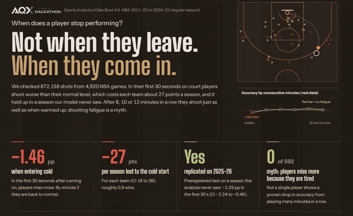
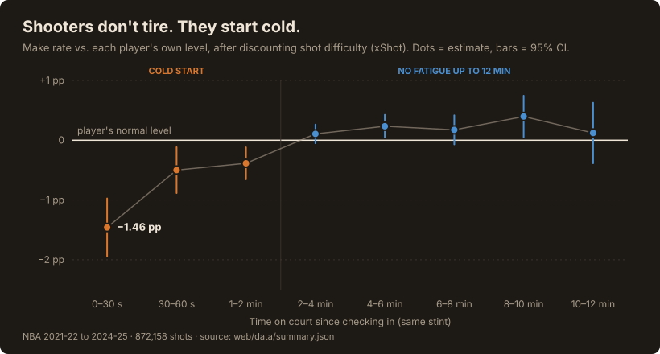
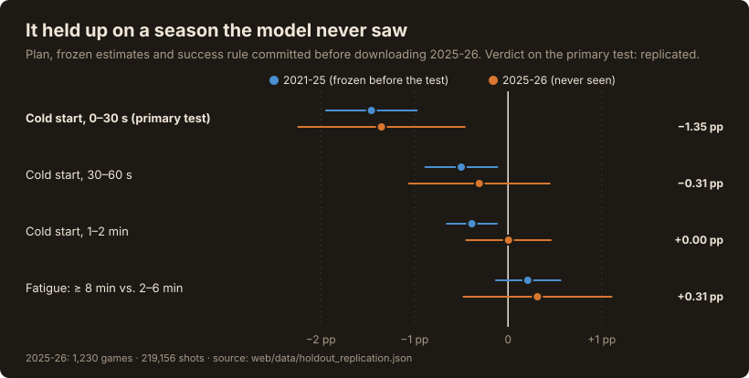
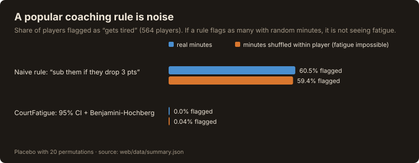
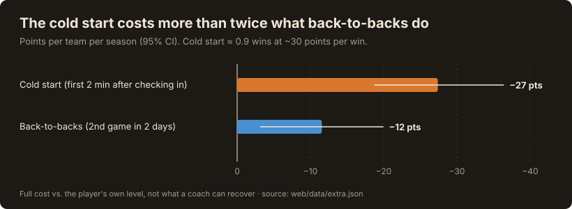

[English](README.md) | [Español](README.es.md)

# CourtFatigue: NBA shooters don't tire — they start cold

**▶ Live app: https://courtfatigue-web.vercel.app/** · **[🎬 Video](https://youtu.be/sOfh15Tk0wY)** · [Devpost](https://devpost.com/software/courtfatigue) · Built for the **AQX Sports Analytics Data Bowl 4.0** · MIT license

> **Coaches worry about minute 10. The leak is second 10.**
>
> 1 in 4 NBA shots is taken within 2 minutes of checking in. In the first 30 seconds, players shoot **1.46 pp below their own level**, and it **replicated on a season the model never saw**. That is **~27 points per team per season**: more than twice the cost of back-to-backs, and almost one win.

[](https://youtu.be/sOfh15Tk0wY)

*Click the animation to watch the full video on YouTube.*

| | Result | 95% CI |
|---|---|---|
| **Cold start** (first 30 s after checking in) | **−1.46 pp** vs. the player's own level | −1.95 to −0.97 |
| **Preregistered replication** on 2025-26 (never seen; plan [committed](https://github.com/JkalasG/CourtFatigue/commit/77aa9f738b5ee23ff68f3701018092b96677a151) before download) | **−1.35 pp** → replicated | −2.24 to −0.46 |
| Cost of the cold start | **~27 points per team per season** (≈ 0.9 wins) | 19 to 36 |
| "Shooting fatigue" after ≥ 8 consecutive min (vs. warmed-up, 2–6 min) | **+0.21 pp**: none | −0.13 to +0.56 |
| Players with a provable fatigue drop | **0 of 592** | FDR-corrected |

- **The myth is wrong in a useful direction.** Coaches pull shooters "before they get tired", but accuracy does not fall up to ~12 consecutive minutes.
- **The real leak is the entry.** Shots in the first 30 s after a substitution are the worst, even free throws (−1.9 pp), where there is no defender. One in four shots (24.6%) is taken in the first 2 minutes after checking in.
- **What a staff can do tomorrow:** design the first possession after a sub for the shot the cold start hurts least (near the rim: −0.8 pp, vs. −1.8 pp on threes and −2.6 pp from mid-range) and get the sub active before they check in. It is free to try: no trade, no cap space, no extra minutes, only how the first play is drawn up. Whether it wins the points back has not been tested yet.

### One shot, made concrete (bench calculator)

Jayson Tatum re-enters after 8 minutes on the bench. 15 seconds in, he gets a three.

- Expected make, 15 s after checking in: **33.6%** (95% interval 31.3% to 35.9%)
- The same three once he has been on court 2+ minutes: **35.5%**
- Near the rim at the same moment, the cold start costs only −0.9 pp (59.0% vs. 59.9%)

That gap is what a coach can design around. Try it in the app under *Tools → Calculator*.

## The evidence in four charts

Every number in these charts is read from the same files the app uses (`web/data/`), by `scripts/build_readme_figures.py`.









> **The proof is in the git history.** The plan, the frozen estimates and the success rule are in [commit 77aa9f7](https://github.com/JkalasG/CourtFatigue/commit/77aa9f738b5ee23ff68f3701018092b96677a151) (29 Oct 2026), made before any 2025-26 file was downloaded; the script refuses to run the test without that commit.
>
> **Read the replication honestly.** The preregistered primary test (first 30 s) replicated. The smaller 30–60 s and 1–2 min windows point the same way in 2021-25, but on their own they are not distinguishable from zero in 2025-26. The absence of fatigue held as well (+0.31 pp).

## How this meets the Data Bowl judging criteria

| Criterion | Where CourtFatigue delivers it |
|---|---|
| **Practical application** | One-page printable coach card; bench calculator for the next shot after a sub; cost in points per team-season; explicit list of what the tool does *not* do |
| **Analytical insight** | Shot-difficulty model (xShot) validated by game and on an unseen season; player fixed effects with clustered errors; random effects + Benjamini-Hochberg; placebo test; selection-bias split by how stints end; **preregistered replication on 2025-26** |
| **Data presentation** | Bilingual (EN/ES) web app; plain-language summary first, technical detail below; 3D simulator showing what weighs most on a shot; every number shown with its 95% CI |
| Working prototype | https://courtfatigue-web.vercel.app/ |
| Public source code | this repository ([MIT](LICENSE)) |
| Sports analytics on a professional sport | NBA, NBA Stats play-by-play and shot data 2021-22 to 2025-26 |
| New project | built for Data Bowl 4.0 |

## Validation

| Check | Result | Baseline / benchmark |
|---|---|---|
| xShot, game-grouped cross-validation | log-loss 0.640, Brier 0.225, AUC 0.657, calibration error 0.17 pp | no model: log-loss 0.691 · logistic regression: 0.646 |
| xShot, unseen season (train 2021-24 → test 2024-25) | log-loss 0.641, AUC 0.654, calibration error 0.50 pp | no model: 0.691 · logistic regression: 0.646 |
| Placebo (minutes shuffled within player) | our rule flags 0.04% | naive "3-pt drop" rule flags 59.4%, vs. 60.5% on real data: it is noise |
| Preregistered replication, 2025-26 | cold start −1.35 pp (CI −2.24 to −0.46) | frozen estimate −1.46 pp |
| Stint adapter for the new play-by-play format | 99.66% of 2024-25 shots get the same stint | original format |
| Selection bias: stints ended for coach-independent reasons (halftime, end of game, foul trouble) | no drop: +0.83 pp (CI +0.24 to +1.41) | all stints: +0.20 pp |
| Tests | 6 statistical tests on synthetic data · 37 calculator checks · 179 simulator checks | `tests/` |

## Main result in detail

**Data:** NBA regular seasons 2021-22 to 2024-25 · 4,920 games · 872,158 shots · 913 players. 2025-26 (1,230 games, 219,156 shots) is used **only** for the preregistered replication.

| Question | Result |
| --- | --- |
| Does accuracy drop after ≥ 8 consecutive min, versus an already warmed-up player (2-6 min)? | **+0.21 pp** (95% CI: −0.13 to +0.56): no. Average drops larger than ~0.13 pp are ruled out |
| Slope per consecutive minute, after warm-up | +0.027 pp/min (95% CI: −0.014 to +0.069): flat |
| Does it repeat season by season? | Yes: +0.41, +0.32, −0.36 and +0.18 pp (all with a CI that includes 0); +0.31 pp in 2025-26 |
| Players with a demonstrable drop (95% CI < 0 and FDR correction) | **0 of 592** |
| Court zones with a significant drop (after warm-up) | **0 of 6**. The two interior zones show a slight improvement (+0.11 and +0.16 pp/min) |
| Player traits that modify the effect | **0 of 7** |
| **Cold start** (after entering the court) | **−1.46 pp** in the first 30 s (CI −1.95 to −0.97), −0.50 pp between 30 and 60 s, −0.39 pp between 1 and 2 min; normal from 2 min. Negative in all 4 seasons (clear interval in 3 of 4); under another stint rule (reset every quarter) it stays at −1.08 pp (CI −1.50 to −0.65). **Replicated on 2025-26: −1.35 pp** |
| Cold start by shot type (first 30 s) | three −1.8 pp · mid-range −2.6 pp · near the rim −0.8 pp · free throws −1.9 pp |
| Does time on the bench matter? | No: −0.04 pp per bench minute (CI −0.12 to +0.03). It is entering the game's rhythm, not cooling down |
| Cost in points | cold start **−27 points per team-season** (CI −36 to −19, ≈ 0.9 wins); back-to-backs −12 (CI −20 to −3) |
| Schedule and context | back-to-back **−0.39 pp** (CI −0.67 to −0.11); playing at home **+0.38 pp** (CI +0.11 to +0.65) |
| Rival defense | Real effect, stable across seasons (r ≈ 0.52): from −1.2 pp (Thunder) to +1.7 pp (Kings) in 2024-25 |
| Teams | No team handles the cold start better than the others beyond noise (between-team spread τ = 0 in all four seasons), so the team audit is not sold as a ranking |

**There is no detectable shooting fatigue up to ~12 consecutive minutes.** This is compatible with current rotations already avoiding the stretches where shooting would deteriorate. What does show up is a **cold start**, and schedule and home court with small but consistent effects. At the individual level power is limited: the typical standard error per player is ~5 pp, so only drops of about 14 pp or more would be detected. That is why the tool labels no player as "the one who tires", and says so.

> **Why the comparison is against warmed-up players.** Comparing ≥ 8 min against everything under 4 min gives +0.65 pp, but that mixes the cold start with fatigue. With the 2-6 min reference the effect drops to +0.21 pp. The slope with all buckets (+0.097 pp/min) is also inflated by the cold start; after warm-up it is +0.027.

### Why inference matters: the naive rule does not work
A rule such as *"substitute when accuracy drops 3 points in some bucket with ≥ 20 shots"* flags **60.5%** of players with real data and **59.4%** when minutes are shuffled at random within each player (where fatigue cannot exist). That is noise. This project's rule (95% CI excludes 0 and Benjamini-Hochberg correction) flags **0%** with real data and 0.04% with random minutes. This comparison is in the *Summary* tab and is verified with synthetic tests in `tests/`.

### Selection bias: do coaches hide fatigue?
Coaches pull players who look tired, which could hide a real drop. So stints were split by how they ended. In stints that ended for reasons the coach does not choose (halftime, end of game, foul trouble) there is still no drop: **+0.83 pp** (CI +0.24 to +1.41). In stints the coach ended, the last 2 minutes before the change are **−9.0 pp** below normal, against −1.9 pp in the last 2 minutes of the other stints: coaches react to recent misses, not to minutes played. It is still association, not causation.

### Robustness
The slope per minute holds under: excluding blowouts (margin ≥ 20), using only close games (≤ 10), controlling for game minutes, home or away, score and back-to-back, resetting the counter every quarter and including shots with an uncertain stint (all between +0.09 and +0.11 pp/min with all buckets; after warm-up, +0.027).

## Uses and benefits for the coaching staff

CourtFatigue **is not an in-game assistant**: it is a tool for planning and for debunking myths. It shows where not to spend energy and where to pay attention. On the website it is the **For the coach** tab, with a printable one-page card.

**What it is useful for**

| Use | What the coach does | What it rests on |
| --- | --- | --- |
| Rotate without fear of "shooting fatigue" | Keep the best shooter on longer if there are no other reasons (fouls, defense, visible wear) to take them off | Up to ~12 consecutive min accuracy does not drop (+0.21 pp after ≥ 8 min; CI −0.13 to +0.56) |
| Prepare the entry from the bench | Design the first play after a substitution for the least affected shot (near the rim), not a pull-up three or a mid-range jumper; get the sub active before entering (a hypothesis to validate) | Cold start: −1.46 pp in the first 30 s, replicated on 2025-26; −0.8 pp near the rim vs. −1.8 pp on threes |
| Manage minutes on back-to-backs | Decide who gets fewer minutes in the second game of two days in a row | Back-to-back: −0.39 pp (CI −0.67 to −0.11), ~12 points per team-season |
| Don't label anyone as "the one who tires" | Check each player with their margin of error in *Tools → Check players* before changing their role | 0 of 592 players with a proven drop |
| Prepare the game by rival | Know against which teams players shoot worse than expected | Defensive effect per team, stable across seasons (r ≈ 0.52) |
| Convince players and executives | Show in the 3D simulator what weighs on a shot: the defender and the distance a lot, fatigue almost nothing | "What weighs most on this shot" panel |

**What it does not do**

- It does not work live: it does not say "take them off now" during a game.
- It does not measure physical fatigue or injury risk, only whether the shot goes in. That needs load data (GPS, heart rate).
- It does not measure defense, rebounds or turnovers, which fatigue could affect.
- It does not see small drops of a specific player: only drops of ≈ 14 pp or more.
- It says nothing beyond ~12 consecutive minutes: there is almost no data there.
- The 27 points are the full cost of the cold start, not what a coach can recover: that has not been tested.

> **In one sentence:** it helps the coaching staff rotate with data instead of intuition. The problem is not when a player leaves, but how they come in.

## Interface

**Live:** https://courtfatigue-web.vercel.app/

Tabs: **Summary** (the answer in plain language, four key numbers and the placebo test) · **For the coach** (printable one-page card with four findings, four actions and the evidence behind each one; how a staff uses it and what it does not do) · **Tools** (*Calculator*: expected make probability of the next shot after a sub; *Check players*: curve, CI, rested vs. tired maps; *New player*: projection with uncertainty) · **Evidence** (the cold start: replication, cost in points, shot type, free throws, bench time; the absence of fatigue: selection bias, robustness, season by season, zones, traits; teams: points-lost audit and team defense) · **3D simulation** (link to the simulator + method).

The language (English or Spanish) is chosen with the EN / ES switch in the top bar; it is remembered in the browser and shared with the simulator. It can also be forced with `?lang=es` or `?lang=en`. The design is inspired by a coach's tactics board: dark wood, chalk-white ink and thin orange court lines as separators.

The page is static (the `web/` folder), with no libraries except Three.js in the simulator. It is deployed on Vercel. How to run it on your computer: see [Instructions to clone and run](#instructions-to-clone-and-run), at the end.

Video: https://youtu.be/sOfh15Tk0wY · Replication plan: [docs/preregistration.md](docs/preregistration.md).

## 3D simulator (`web/simulador/`)

### What it is for in this analysis

The simulator **is not a separate analysis and discovers nothing new**: it puts the effects the analysis already measured into a single shot, so they can be understood without reading confidence intervals. It serves three purposes:

1. **Comparing the size of each effect.** The *"What weighs most on this shot"* panel shows how many points of accuracy each factor adds or takes away: shot distance, defender, rival team, cold start and fatigue. Raising the consecutive minutes from 2 to 12 barely moves the fatigue bar; bringing the defender closer or moving the shot back changes the probability by several points. It is the project's main conclusion, seen in practice.
2. **Seeing the cold start.** With the player just in (under 2 min), the probability drops and then returns to its level: it is the only effect of minutes that does show up in the data.
3. **Explaining it to people who don't read charts** (coaching staff, players, judges): every number comes from data, and what is only illustrative (the positions of the other four defenders, the animation) is labelled as such.

What it does **not** do: it does not predict real in-game shots or measure a specific player's fatigue; the fatigue it uses is the league-average slope.

### How it computes the probability

The scoring probability is built by adding measured terms; nothing is hand-written:

| Term | Source |
| --- | --- |
| Player base accuracy | each player's real FG% in 2021-25 |
| Shot distance | accuracy-by-distance curve from our 4 seasons (e.g. −11 pp on a 25 ft three) |
| Defender distance (1.5-8 ft) | 128,065 shots from 2014-15 with that data (CC0), monotone gradient boosting with a game-resampling confidence band. The adjustment is **relative to the typical defender distance for that shot type** (≈5.5 ft on a three, ≈2.3 ft near the rim), because the shot-distance curve already includes how closely it is usually guarded; this way nothing is counted twice |
| Rival team | the team's defensive effect in 2024-25, shrunk toward the league |
| Cold start | measured: −1.46 pp (0-30 s), −0.50 pp (30-60 s), −0.39 pp (1-2 min) |
| Fatigue | slope measured after warm-up (+0.027 pp/min; pessimistic scenario: lower bound of the CI) |

The defender distance starts at the typical value for each shot (it can be set by hand). The shot follows a **physical parabola** (projectile motion from the hand to the hoop, with launch speed and angle computed; no hand-written arc heights) shown dotted before shooting and as a trail during flight, and the TV camera is lateral so it is seen from the side. The positions of the other four defenders are **illustrative**; only the main defender has an effect, through their distance to the shooter, and they are drawn slightly off the line to the hoop, as defenders play in practice. The defender-distance effect is association on data from another era and mixes in fast breaks with no defender; the rival effect is the team average, not that of a specific defender.

## Methodology

> **Data quality and cleaning:** [DATA_QUALITY.md](DATA_QUALITY.md) (shot funnel, checks per season, cross-check between the two sources and what was done about each finding).

1. **Stints** (`src/stint_calculator.py`): consecutive minutes on court at the moment of each shot, counting game-clock time only. The counter continues across Q1→Q2 and Q3→Q4 and **resets at halftime**. The play-by-play does not record substitutions between quarters: in each quarter we detect who was already on court and they keep their counter if they came from the previous quarter. Only ~0.3% of shots have an uncertain stint and they are excluded from the main analysis. The shooter team's margin and the home flag are also saved.
2. **Expected shot** (`src/xshot_model.py`): gradient boosting on distance, coordinates, zone, shot type, period and time remaining; no minutes on court or player identity. Double validation: game-grouped cross-validation (log-loss 0.6397 vs. 0.6913 without a model, AUC 0.657, calibration error 0.17 pp) and **temporal** (train on 2021-22 to 2023-24 and evaluate on 2024-25, which it never saw: log-loss 0.6407 vs. 0.6910, AUC 0.654, calibration 0.50 pp). Metrics in `data/processed/xshot_metrics.json`.
3. **Fatigue effect** (`src/fatigue_stats.py`): each player is compared with their own level **in that season**. Per-player contrast (residual with ≥ 8 min − residual with 2-6 min), slope with fixed effects and player-clustered robust errors, random effects (DerSimonian-Laird) for differences between players, Benjamini-Hochberg correction and placebo test.
4. **Cold start, schedule and context**: performance by time since entering, by quarter and by first entry vs. re-entry; control for back-to-back (computed from dates), home and score.
5. **Coaching analyses** (`scripts/build_extra_analyses.py`): cost in points per team-season (game bootstrap), cold start by shot type, free throws, time on the bench, selection bias by how each stint ended, and the per-team audit.
6. **Preregistered replication** (`scripts/holdout_replication.py`, plan in [docs/preregistration.md](docs/preregistration.md)): plan, frozen estimates and success rule committed before downloading 2025-26; the xShot model stays frozen (trained only on 2021-25). The new play-by-play format is mapped with an adapter validated on 2024-25 (99.66% of shots get the same stint).
7. **Defense** (`scripts/build_defense_data.py`): team effect (with empirical-Bayes shrinkage) and defender-distance table.
8. **New player**: baseline accuracy from their shot profile by zone + level; the fatigue effect comes from the population distribution (mean and τ). If own shots are entered they are combined by precision (normal-normal).
9. **Uncertainty**: everything is shown with a 95% CI; buckets with few shots are flagged and not interpolated.

## Limitations

- **Association, not causation**: coaches substitute whoever they see as tired, so long stints are biased toward players who are doing well. The split by how stints ended (see *Selection bias*) shows no drop where the coach did not choose the end, but it does not remove the bias completely.
- **No defender data in the main analysis.** In 2014-15, knowing the defender distance raises the expected-shot AUC from 0.617 to 0.634 (0.642 with shot clock, touch time and dribbles). Our model leaves that part as noise, and we cannot check whether it biases the comparison between minutes.
- No individual physical-condition or load data.
- There are almost no shots after more than ~12 consecutive minutes: beyond that, any projection is extrapolation.
- Limited power per player (see above). "Not detected" does not mean "does not exist".
- The cost in points is the full cost of the cold start; how much of it a coach can recover (for example with a rhythm first play) has not been tested.
- The defender-distance effect comes from another era (2014-15, incomplete season) and another measurement system.
- The thresholds (2-6 min as reference, 8 min as "long") are a choice; the continuous slope is reported as an alternative.

## Future work

Testing the fix (does a rhythm first play after a sub reduce the cold start?) · tracking data (defender positions) in recent seasons · accumulated load from travel and schedule · biometrics · defensive impact of fatigue · replicating again on 2026-27 with the same preregistered rule.

## Data

Four sets are used: NBA **shots** and **play-by-play** (4 seasons, 2021-22 to 2024-25), the **2025-26** season (only for the preregistered replication) and a 2014-15 shot log with **defender distance** (CC0).

> **Descriptive table of the datasets, with download links, licenses and generated files:** [DATASETS.md](DATASETS.md). Column dictionary: [data/README.md](data/README.md).

## System structure

Data go through `src/` (analysis calculation), `scripts/` (packaging) and `web/` (page and 3D simulator).

```text
src/       stints, expected-shot model (xShot) and statistics
scripts/  downloads, data quality, web data, coaching analyses, 2025-26 replication, README charts
web/      the app (HTML, CSS, JS), its data (web/data/) and the 3D simulator (web/simulador/)
tests/    statistics (Python), bench calculator and simulator (Node)
docs/     preregistration, README images, Spanish docs
```

**Tech stack:** Python (pandas, NumPy, scikit-learn), plain HTML/CSS/JavaScript with hand-made SVG charts, Three.js for the simulator, Node for the JS tests, Vercel for hosting. CPU only.

> **What each folder and file does:** [STRUCTURE.md](STRUCTURE.md).

## Credits and license

- AQX Analytics Hackathon and Devpost logos: they belong to their owners; they are used to identify the competition.
- 3D court: Three.js (MIT).
- Code license: [MIT](LICENSE).

## Instructions to clone and run

**Requirements**

- **Git** and **Python 3** (tested with Python 3.14, pandas 3.1, NumPy 2.5 and scikit-learn 1.9).
- **Node.js** only for the calculator and simulator tests (step 4; tested with Node 24).
- To reproduce the analysis (step 3): an internet connection, about **1.5 GB** of free disk space and about **10 minutes**.
- Viewing the page (step 2) needs nothing but Python.

**1. Clone and install**

```bash
git clone https://github.com/JkalasG/CourtFatigue.git
cd CourtFatigue
python -m venv venv
venv\Scripts\activate           # Windows (on macOS/Linux: source venv/bin/activate)
pip install -r requirements.txt
```

**2. View the page and the simulator** (the results already ship generated in `web/data/`)

```bash
cd web
python -m http.server 8000      # open http://localhost:8000
```
A local server is needed because the browser blocks `fetch` from `file://`. The 3D simulator is at `http://localhost:8000/simulador/`.

**3. Reproduce the analysis from scratch** (optional; downloads hundreds of MB)

```bash
python scripts/download_seasons.py 2021 2022 2023 2024   # NBA 2021-22 to 2024-25 (for 2024-25 the repo only ships the shots)
python scripts/download_shot_logs.py                # 2014-15 with defender distance (CC0)

python src/stint_calculator.py 2021 2022 2023 2024  # ~3 min per season
python src/xshot_model.py                           # expected-shot model (cross-validated + temporal)
python scripts/data_quality.py                      # data-quality audit -> DATA_QUALITY.md
python scripts/build_web_data.py                    # statistics and interface data (includes placebo)
python scripts/build_defense_data.py                # team defense and defender distance
python scripts/build_defense_data.py gap            # accuracy gap with and without defender data
python scripts/build_extra_analyses.py              # cost in points, shot type, free throws, bench time, selection bias
python scripts/holdout_replication.py validate      # adapter check on 2024-25
python scripts/holdout_replication.py run           # preregistered 2025-26 replication
python scripts/build_readme_figures.py              # the README charts, from web/data/
```

**4. Tests**

```bash
python tests/test_fatigue_stats.py                  # 6 tests on synthetic data
node tests/test_calculator.js                       # bench calculator vs. the Python output (37 checks)
curl -o tests/three.min.js https://cdnjs.cloudflare.com/ajax/libs/three.js/r128/three.min.js
node tests/test_simulator.js                        # probability model, defenders and shot physics (179 checks)
```

The 2024-25 play-by-play (94 MB) is not versioned: `download_seasons.py ... 2024` fetches it into `data/raw/seasons/2024/`, and `stint_calculator.py` reads it from there when `data/raw/nbastats_2024.csv` is absent. The extra seasons, the external dataset and the large processed CSVs (including the `data/processed/extra/` cache) are regenerated with the scripts and are in `.gitignore`.

**Expected result.** Following these steps in a clean copy of the repository produces exactly the same files in `web/data/` (results, players, shot maps, defense and data quality) and the same quality report. The only possible difference is in the fifth decimal of the logistic model's metrics, which is only a comparison baseline and is not used in the analysis; it depends on the scikit-learn version.
